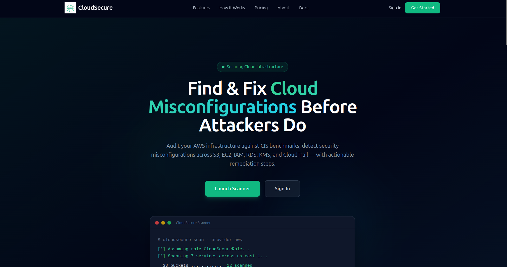
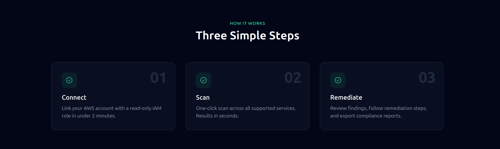
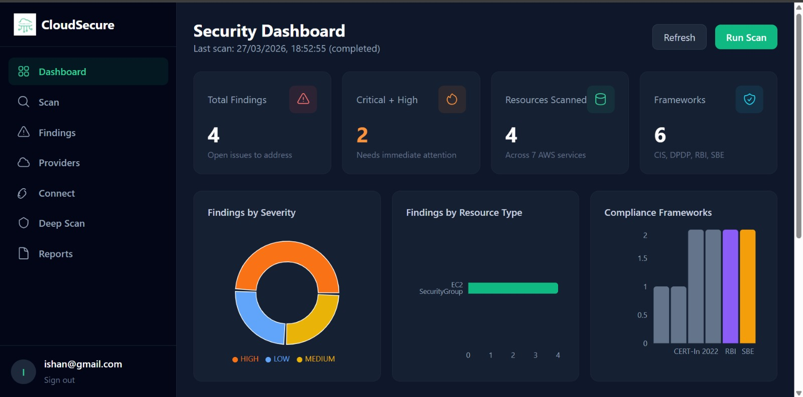
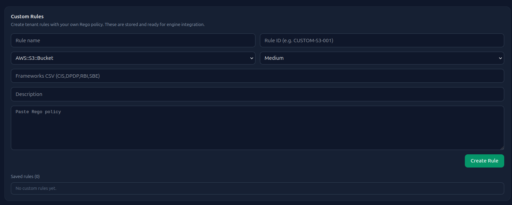
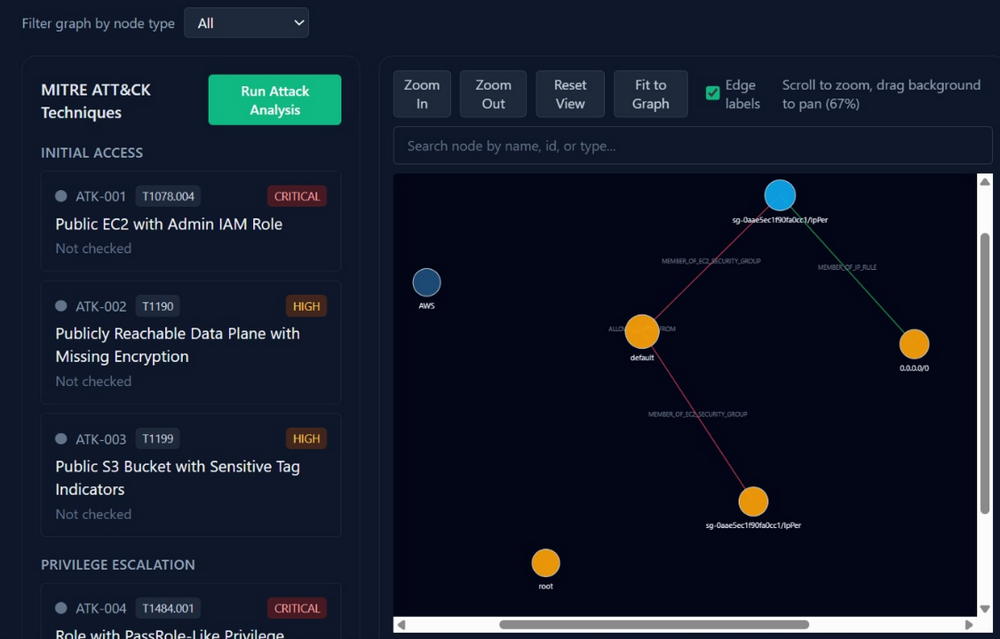

<h1 align="center">
  
  <br>
  CloudSecure
  <br>
  
</h1>

<h4 align="center">Open-source Cloud Security Posture Management (CSPM) for AWS</h4>

<p align="center">
  
  
  
  
  
  
</p>

<p align="center">
  <a href="#-features">Features</a> •
  <a href="#-supported-aws-services">AWS Services</a> •
  <a href="#-compliance-frameworks">Frameworks</a> •
  <a href="#-how-it-works">How It Works</a> •
  <a href="#-architecture">Architecture</a> •
  <a href="#-getting-started">Getting Started</a> •
  <a href="#-screenshots">Screenshots</a> •
  <a href="#-useful-commands">Commands</a>
</p>

---

> **CloudSecure** is an open-source Cloud Security Posture Management (CSPM) platform that continuously scans your AWS environment, detects misconfigurations, maps attack paths, and produces actionable compliance findings — all from a single self-hosted dashboard.

<p align="center">
  
</p>

---


## ✨ Features

| Feature | Description |
|---|---|
| **One-click AWS Scan** | Scans S3, EC2, IAM, RDS, KMS, and CloudTrail in under 5 minutes |
| **350+ Security Checks** | CIS Benchmark and India-specific regulatory rules powered by OPA/Rego |
| **Attack Path Analysis** | Neo4j-backed graph engine maps lateral movement and privilege escalation paths |
| **Deep Scan / Graph View** | Interactive node-graph visualization of your entire AWS resource topology |
| **Compliance Reporting** | Exportable reports mapped to CIS, DPDP, RBI, and SBE frameworks |
| **Multi-tenant** | Isolated workspaces per team or customer |
| **Real-time Findings** | Findings appear as resources are scanned — no waiting for full completion |
| **Suppression Workflow** | Mark findings as suppressed to track accepted risk |
| **Delta Scanning** | Incremental scans only re-fetch resources that have changed |

---

## ☁️ Supported AWS Services

| Service | Checks | Standards |
|---|---|---|
| **Amazon S3** | Public access, encryption, versioning, logging, bucket policy | CIS, DPDP, RBI |
| **Amazon EC2** | Security groups, open ports, IMDSv2, public IPs | CIS, SBE |
| **AWS IAM** | MFA, inline policies, role trust policies, access keys | CIS, DPDP |
| **Amazon RDS** | Public access, encryption, backup retention, deletion protection | CIS, RBI |
| **AWS KMS** | Key rotation, key policy, multi-region keys | CIS, DPDP |
| **AWS CloudTrail** | Logging enabled, log validation, CloudWatch integration | CIS, SBE |

---

## 📋 Compliance Frameworks

CloudSecure maps every finding to one or more compliance frameworks:

- **CIS AWS Foundations Benchmark** — Industry-standard hardening guidelines
- **DPDP (Digital Personal Data Protection)** — India's 2023 data protection law
- **RBI Cyber Security Framework** — Reserve Bank of India guidelines for BFSI
- **SBE (SEBI Basic Cyber Hygiene)** — Securities and Exchange Board of India baseline

---

## 🔄 How It Works

<p align="center">
  
</p>

1. **Connect** — Link your AWS account with a read-only IAM role in under 2 minutes
2. **Scan** — One-click scan across all supported services. Results in seconds
3. **Remediate** — Review findings, follow remediation steps, and export compliance reports

---

## 🖼️ Screenshots

### Security Dashboard
<p align="center">
  
</p>

<p align="center">
  
</p>

The dashboard gives you an at-a-glance view of your security posture:
- **Total Findings** — open issues to address
- **Critical + High** — findings needing immediate attention
- **Resources Scanned** — count across all AWS services
- **Frameworks** — active compliance mappings (CIS, DPDP, RBI, SBE)
- Breakdowns by severity, resource type, and compliance framework

### Attack Path Analysis
<p align="center">
  
</p>

---

## 🏗️ Architecture

```
┌─────────────────────────────────────────────────────────────┐
│                        Browser                              │
│              React + Vite (port 3000)                       │
└──────────────────────────┬──────────────────────────────────┘
                           │ REST API
┌──────────────────────────▼──────────────────────────────────┐
│                   Django Backend (port 8000)                 │
│         DRF Token Auth · Multi-tenant · REST API            │
└──────┬────────────┬─────────────────┬───────────────────────┘
       │            │                 │
┌──────▼───┐  ┌─────▼──────┐  ┌──────▼──────┐
│PostgreSQL│  │   Valkey   │  │    Neo4j    │
│  (state) │  │  (broker)  │  │  (graph)    │
└──────────┘  └─────┬──────┘  └─────────────┘
                    │
         ┌──────────▼──────────┐
         │    Celery Workers   │
         │  inventory · rules  │
         └──────────┬──────────┘
                    │
         ┌──────────▼──────────┐    ┌─────────────┐
         │     AWS (boto3)     │    │  OPA Server │
         │  STS AssumeRole     │    │ Rego Policies│
         └─────────────────────┘    └─────────────┘
```

| Component | Technology | Role |
|---|---|---|
| Frontend | React 18 + Vite + Tailwind | Dashboard UI |
| Backend | Django 4 + Django REST Framework | API server, auth, tenant logic |
| Task Queue | Celery + Valkey | Async inventory pulls and rule evaluation |
| Database | PostgreSQL 15 | Findings, inventory runs, user/tenant data |
| Graph DB | Neo4j 5 | Resource relationship graph, attack paths |
| Policy Engine | OPA (Open Policy Agent) + Rego | Security rule evaluation |
| AWS Integration | boto3 + STS AssumeRole | Read-only AWS resource discovery |

---

## 🚀 Getting Started

### Prerequisites

- [Docker Desktop](https://www.docker.com/products/docker-desktop/) installed and running
- [AWS CLI](https://aws.amazon.com/cli/) configured with valid credentials (`aws configure`)
- An AWS account where you can create IAM roles

---

### 1. Clone the Repository

```bash
git clone https://github.com/your-org/CloudSecure.git
cd CloudSecure
```

---

### 2. Configure Environment

```bash
cp .env.example .env
```

Edit `.env` with your values:

| Variable | Description | Example |
|---|---|---|
| `SECRET_KEY` | Django secret key | `python -c "import secrets; print(secrets.token_urlsafe(50))"` |
| `POSTGRES_DB` | PostgreSQL database name | `cloudsecure` |
| `POSTGRES_USER` | PostgreSQL username | `cloudsecure` |
| `POSTGRES_PASSWORD` | PostgreSQL password | `localpostgres123` |
| `POSTGRES_HOST` | PostgreSQL host (Docker service name) | `db` |
| `POSTGRES_PORT` | PostgreSQL port | `5432` |
| `VALKEY_URL` | Valkey/Redis broker URL | `redis://valkey:6379/0` |
| `NEO4J_URI` | Neo4j bolt URI | `bolt://neo4j:7687` |
| `NEO4J_USER` | Neo4j username | `neo4j` |
| `NEO4J_PASSWORD` | Neo4j password (min 8 chars) | `localneo4j123` |
| `DJANGO_SETTINGS_MODULE` | Django settings module | `cloudsecure.settings.local` |
| `AWS_DEFAULT_REGION` | Region where Resource Explorer aggregator is active | `us-east-1` |
| `AWS_ACCESS_KEY_ID` | Leave blank — uses `~/.aws` credentials | _(blank)_ |
| `AWS_SECRET_ACCESS_KEY` | Leave blank — uses `~/.aws` credentials | _(blank)_ |
| `DEBUG` | Django debug mode | `True` |

---

### 3. AWS Setup (One-time)

CloudSecure uses an IAM role with read-only permissions. Run these commands once:

```bash
# Get your AWS Account ID
aws sts get-caller-identity --query Account --output text

# Enable Resource Explorer (required for resource discovery)
aws resource-explorer-2 create-index --type AGGREGATOR --region us-east-1

# Verify the index is ACTIVE (may take several minutes to over an hour)
aws resource-explorer-2 get-index --region us-east-1

# Create the CloudSecure IAM role
aws iam create-role \
  --role-name CloudSecureRole \
  --assume-role-policy-document file://trust-policy.json

# Attach read-only permissions
aws iam put-role-policy \
  --role-name CloudSecureRole \
  --policy-name CloudSecurePermissions \
  --policy-document file://permissions-policy.json
```

> `trust-policy.json` and `permissions-policy.json` are included in this repository.

---

### 4. Build & Start

```bash
make build            # Build Docker images
make up               # Start all services
make migrate          # Run database migrations
make createsuperuser  # Create your admin account
```

---

### 5. Open the App

| Service | URL |
|---|---|
| **Dashboard** | http://localhost:3000 |
| **API** | http://localhost:8000 |
| **Neo4j Browser** | http://localhost:7474 |

1. Log in at http://localhost:3000/login
2. Go to **Connect** → enter your AWS Account ID and role name `CloudSecureRole`
3. Click **Test Connection** — a green check confirms the role works
4. Go to **Scan** → click **Run Scan**
5. Findings will appear in **Findings** as the scan progresses

---

## 🛠️ Useful Commands

| Command | Description |
|---|---|
| `make up` | Start all services |
| `make down` | Stop all services |
| `make build` | Build Docker images |
| `make rebuild` | Rebuild images and restart |
| `make migrate` | Run database migrations |
| `make createsuperuser` | Create an admin user |
| `make logs` | Tail backend + celery logs |
| `make frontend-logs` | Tail frontend logs |
| `make all-logs` | Tail all service logs |
| `make shell` | Open Django shell |

---

## 🔑 Required IAM Permissions

CloudSecure's IAM role requires the following read-only permissions:

```json
{
  "Version": "2012-10-17",
  "Statement": [
    {
      "Effect": "Allow",
      "Action": [
        "resource-explorer-2:Search",
        "resource-explorer-2:GetIndex",
        "resource-explorer-2:GetDefaultView",
        "resource-explorer-2:ListViews",
        "s3:GetBucketPolicy",
        "s3:GetBucketAcl",
        "s3:GetBucketEncryption",
        "s3:GetBucketVersioning",
        "s3:GetBucketLogging",
        "s3:GetPublicAccessBlock",
        "ec2:DescribeInstances",
        "ec2:DescribeSecurityGroups",
        "iam:GetRole",
        "iam:GetUser",
        "iam:ListRolePolicies",
        "iam:GetRolePolicy",
        "iam:ListUserPolicies",
        "iam:GetUserPolicy",
        "iam:ListMFADevices",
        "rds:DescribeDBInstances",
        "kms:DescribeKey",
        "kms:GetKeyPolicy",
        "kms:GetKeyRotationStatus",
        "cloudtrail:DescribeTrails",
        "cloudtrail:GetTrailStatus",
        "cloudtrail:GetEventSelectors",
        "sts:GetCallerIdentity"
      ],
      "Resource": "*"
    }
  ]
}
```

---

## 🐛 Troubleshooting

**`NoCredentialError` on connection test**
The backend mounts `~/.aws` from your host. Run `aws configure` on your machine, or set `AWS_ACCESS_KEY_ID` and `AWS_SECRET_ACCESS_KEY` in `.env`.

**`Resource Explorer index not found`**
Run `aws resource-explorer-2 create-index --type AGGREGATOR --region us-east-1` and wait for the index to reach `ACTIVE` state (can take several minutes to over an hour). Verify with `aws resource-explorer-2 get-index --region us-east-1`. Ensure `AWS_DEFAULT_REGION=us-east-1` in your `.env`.

**`Password authentication failed` for PostgreSQL**
The Postgres volume was likely initialized with a different password. Reset it:
```bash
docker compose down -v
docker compose up -d
make migrate
```

**Neo4j connection refused**
Neo4j takes ~30 seconds to start. Run `make logs` and wait for `Started.` before triggering a scan.

**Celery not picking up tasks**
Check `make logs` — you should see `celery@... ready`. If not, restart with `docker compose restart celery`.

**Findings not appearing after scan**
Ensure OPA is running (`docker compose ps`) and the Rego policies loaded successfully. Check celery logs for `OPA policies loaded`.

**Frontend blank page or CORS errors**
Rebuild the frontend: `docker compose up -d --build frontend`. Check browser console for failing API requests.

---

## 🤝 Contributing

Contributions are welcome! Please open an issue first to discuss what you'd like to change.

1. Fork the repository
2. Create a feature branch (`git checkout -b feature/amazing-feature`)
3. Commit your changes (`git commit -m 'Add amazing feature'`)
4. Push to the branch (`git push origin feature/amazing-feature`)
5. Open a Pull Request

---

## 📄 License

This project is licensed under the MIT License — see the [LICENSE](LICENSE) file for details.

---

<p align="center">
  Built by <strong>Team Kaalitopi</strong> · Cloud Security Scanner
</p>
